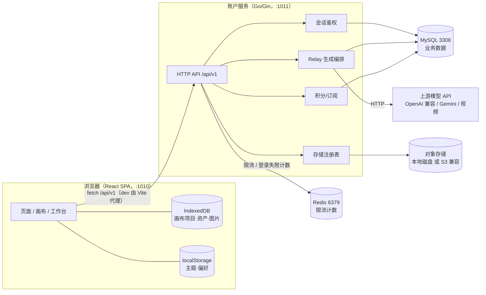
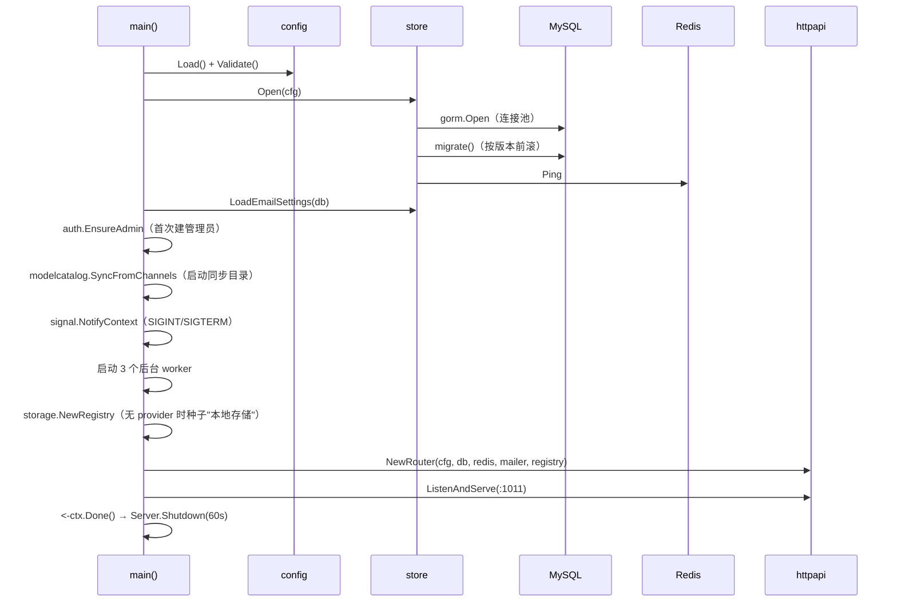
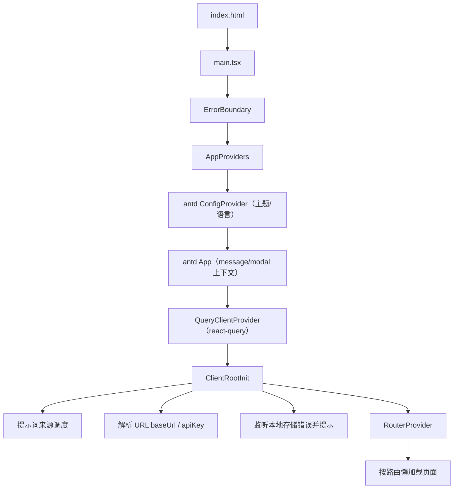
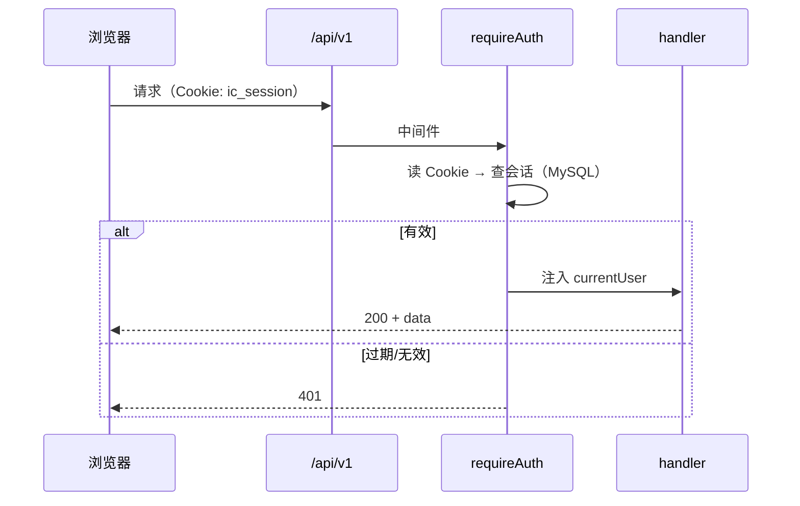
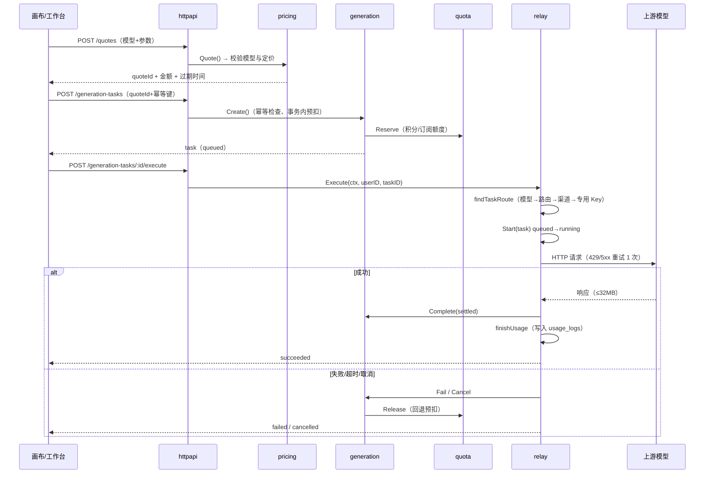
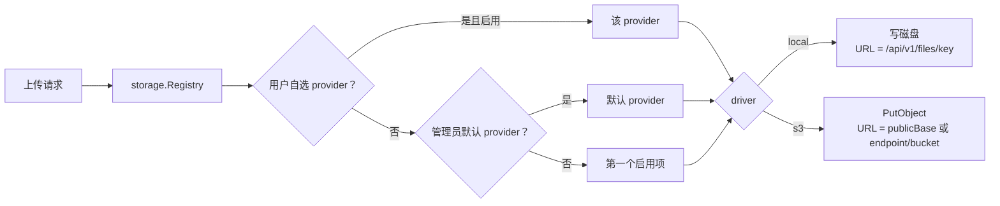

# 项目运行链路（架构总览）


> 依据当前代码核实（`server/main.go`、`server/internal/httpapi/router.go`、`server/internal/relay/service.go`、`web/src/main.tsx`、`web/src/pages/canvas/`）。Mermaid 图在支持的环境可直接渲染；上图源文件为 `docs/public/images/architecture.svg`。

## 1. 部署拓扑



**本地模式特例**：`VITE_APP_MODE=local`（或 `web/.env.test`）时，浏览器**直连**用户自己配置的 OpenAI 兼容接口，API Key 存在浏览器，不经过账户服务；托管模式才走 `/api/v1` 的 Relay。

## 2. 后端启动链路



**后台 worker（全部随主 ctx 退出）**：

| worker | 周期 | 作用 |
| --- | --- | --- |
| `reapStaleTasks` | `RELAY_TIMEOUT + 1min` | 回收进程中断遗留的 queued/running 任务并退额度 |
| `expireOrders` | 1 分钟 | 批量把超时未支付订单置 `expired` |
| `maintainData` | 1 小时 | 过期报价置 `expired`；按保留期分批清理审计/访问/用量日志 |

## 3. 前端启动链路



路由均为 `lazy()` 加载，`Suspense` 兜底；`/canvas/:id`、`/projects/:id` 进入画布壳。

## 4. 鉴权链路



限流与登录失败计数走 Redis（`allowGuard`、`loginAllowed`），会话本身存 MySQL。

## 5. 托管生成链路（核心）



**关键约束**：取消前先按 `userID` 校验归属；上游 Key 只在 Relay 内部解密使用，不序列化、不写日志。

## 6. 存储解析链路



管理员在后台配置 providers（AK/SK 加密入库、只回掩码），用户在「我的 → 设置」里自选；没有启用项时上传直接报错，不会静默落到未知位置。

## 7. 数据落点

| 数据 | 位置 | 说明 |
| --- | --- | --- |
| 账户、会话、积分、订单、生成任务、用量日志 | MySQL | 迁移按版本前滚（`store/migrate.go`） |
| 限流计数、登录失败计数 | Redis | 窗口过期自动清理 |
| 画布项目、画布内图片、生成历史 | 浏览器 IndexedDB（localforage） | 目前不云同步 |
| 主题、语言、侧栏宽度等 | localStorage | 只放极小配置 |
| 资产/媒体原文件（v0.23 起） | 对象存储 | 本地磁盘或 S3 兼容 |

## 8. 一次生成的数据流（简版）

```
用户拖入参考图 → 生成配置节点（提示词）→ 点击生成
  → 前端组装 generationConfig（模型/质量/尺寸/参考图）
  → 托管模式：/quotes → /generation-tasks → /execute → Relay → 上游
  → 返回 dataURL/URL → 存 IndexedDB → 写入节点 metadata → 画布渲染
  → usage_logs 记录模型、耗时、质量、积分
```

## 9. 故障与降级点

| 环节 | 故障表现 | 现有处理 |
| --- | --- | --- |
| 上游 429/5xx | 请求失败 | 重试 1 次，仍失败判失败并退额度 |
| 上游超大响应 | 内存风险 | 32MB 上限，超限判失败 |
| 进程被杀 | 任务停在 running | 重启后 reaper 超时回收退额度 |
| Redis 不可用 | 限流失效 | 现有实现为放行（fail-open），需注意 |
| 本地存储写满 | 上传失败 | 前端提示「本地存储写入失败」 |
| 迁移失败 | 服务起不来 | `migrate` 返回错误即 `log.Fatal` |
